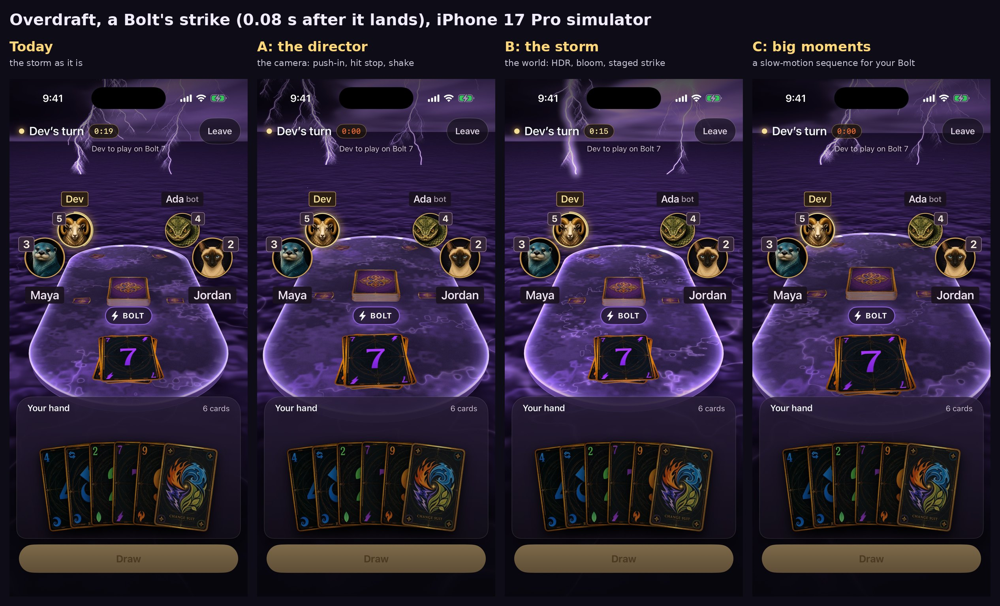
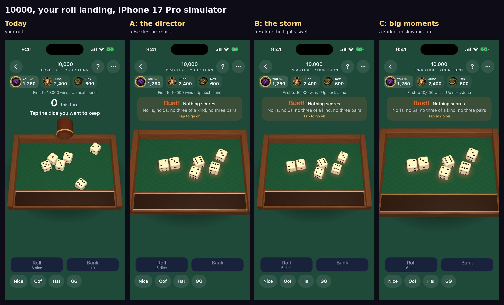

# Cinematic arenas: the three options side by side (#708)

Built on branch `app-708-cinematic` in time2play-app, nothing on main. Each option is turned on with a launch argument
(`-t2p-cinema director | storm | moments`); without one, the app is as it is today. The research behind them is in
`docs/app/cinematic.md`.

| | A: the director | B: the storm | C: big moments only |
| --- | --- | --- | --- |
| What does the work | The camera: a held beat, push-in, 100 ms hit stop, trauma shake (about 1.3° at most) | The world: HDR and bloom, a staged strike (darken, leader, return stroke, afterglow), thunder from one AHAP | The camera, rarely: about a second of slow motion with the camera close in |
| When | Every Bolt that lands (yours at full strength), every one of your rolls; storm strikes get a light rumble | Every strike (a Bolt aimed at you brings one); your dice landing get a warm swell of light | Only your Bolt, a suit change, your hot dice or Farkle; otherwise play as today |
| Recordings (recent phone) | director/recent-overdraft.mp4, director/recent-dice.mp4 | storm/recent-overdraft.mp4, storm/recent-dice.mp4 | moments/recent-overdraft.mp4, moments/recent-dice.mp4 |
| Older phone | director/older-*.mp4 | storm/older-*.mp4 | moments/older-*.mp4 |
| Frame rate vs today, same run (simulator) | 38.7 vs 40.5: no real cost | 17.6 vs 24.7: about 30% fewer frames (HDR and bloom every frame) | 17.9 vs 18.0: no real cost |
| Battery | Nothing added on the GPU | The bloom passes run every frame: a real cost; measure on a phone | Nothing added on the GPU |
| Flashes (flashcheck.py, every recording, both phones) | 0 general, 0 red in any second | 0 general, 0 red | 0 general, 0 red |
| Reduce Motion | Nothing | No strikes, no flashes (as today) | Nothing |
| Readability | Hand, scores and words never move; the pile stays sharp at full shake | Cards and suit colors unchanged under HDR | Hand and words never move; the table holds still in slow motion |
| Not judged yet | | The thunder: the simulator has no haptics, and its recordings have no sound | |

Simulator frame rates swing from run to run (today's own ranged from 18 to 40), so only each run's own "today"
comparison means anything. A phone's real frame rate and battery need TestFlight and Instruments.

Combinations are cheap: the three share the same pieces (CameraDirector, StormStrike, Thunder), so, for example, C's
moments could be told with A's camera and B's thunder.
